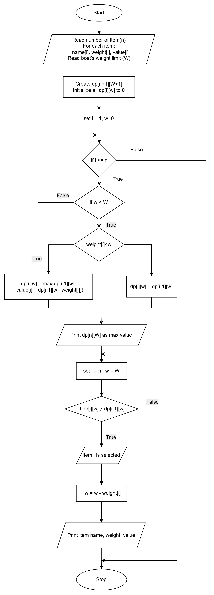

# Flood Relief Optimization with 0/1 Knapsack DP

A **CSC4202 (Design and Analysis of Algorithms)** group project at Universiti Putra Malaysia.

During the Kelantan floods, rescue boats have a strict weight limit and far more relief supplies than they can carry. This project uses **dynamic programming (0/1 knapsack)** to decide which supplies to load so that the total *worth* (urgency/usefulness) is as high as possible without exceeding the boat's capacity.

**Full write-up (scenario, algorithm comparison, correctness proof, complexity analysis, testing, reflection):**
https://asteraaaaa.github.io/CSC4202-DPKnapsack/

## The problem

| Boat | Capacity |
| --- | --- |
| Small Rescue Boat | 35,000 g (35 kg) |
| Medium Rubber Boat | 70,000 g (70 kg) |

There are 32 relief items (water, medicine, food, hygiene, shelter, tools...). Each has a **weight in grams** and a **worth** score ([`src/main/resources/item.tsv`](src/main/resources/item.tsv)). Every item can be taken **at most once**, so this is the 0/1 knapsack problem.

## Why dynamic programming?

- **Greedy** (best worth-per-gram first) is fast but can miss the optimum for 0/1 items.
- **Brute force** checks all 2ⁿ subsets, which is infeasible as n grows.
- **DP** finds the guaranteed optimum in O(n·W) time by reusing solutions to smaller subproblems.

Recurrence, where `dp[i][w]` is the best worth using the first `i` items with capacity `w`:

```
dp[i][w] = dp[i-1][w]                                        if weight_i > w
dp[i][w] = max(dp[i-1][w], dp[i-1][w - weight_i] + worth_i)  otherwise
```

The chosen items are recovered by backtracking through the table.

| | Complexity |
| --- | --- |
| Time | O(n · W) |
| Space | O(n · W) (can be O(W) if you don't need the item list) |

## Program flow



## Run it

Requires **JDK 17+** and **Maven 3.6+**.

```bash
mvn compile exec:java          # uses the bundled item.tsv
mvn compile exec:java -Dexec.args="path/to/your_items.tsv"   # use your own data
mvn test                       # run the unit tests
```

Custom data is a tab-separated file with one item per line: `name<TAB>weight_in_grams<TAB>worth`. Blank or malformed lines are skipped with a warning.

### Sample output

```
Small Rescue Boat (capacity 35000 g)
Dynamic Programming Result
Speed: 18 ms

Total weight:  34020 g
Total worth:   12530
Remaining capacity: 980 g

Items selected:
1. Small Bottled Water (3L) (Value: 800, Weight: 3000)
2. Prescription Medicines (Value: 1000, Weight: 1000)
3. Medical Kit (Value: 950, Weight: 3000)
...
19. Energy Bars Pack (Value: 650, Weight: 1000)
```

For the Medium Rubber Boat (70,000 g) the optimum is a total worth of **15,790** at 68,020 g. Timing varies by machine.

## Project structure

```
├── src/main/java/com/CSC4202/
│   ├── Main.java               # runs both boats
│   ├── DPKnapsackSolver.java   # DP table fill + backtracking
│   ├── ItemReader.java         # reads the tab-separated item file
│   └── Item.java               # name, worth, weight
├── src/main/resources/item.tsv # relief item dataset
├── src/test/java/              # JUnit 5 tests (known cases, edge cases, brute-force check)
├── docs/                       # project website (GitHub Pages)
└── pom.xml
```

## Testing

`mvn test` runs 8 tests, including the report's worked example, edge cases (no items, zero capacity, everything too heavy, single item), input validation, and 200 random cases checked against a brute-force solver.

## Team: Nyonyoo Group

Nurul Izzah Mardhiyyah, Adibah Nawal, Filzah Irdina, Muhammad Hazuan. See the [project page](https://asteraaaaa.github.io/CSC4202-DPKnapsack/) for roles and contacts.
